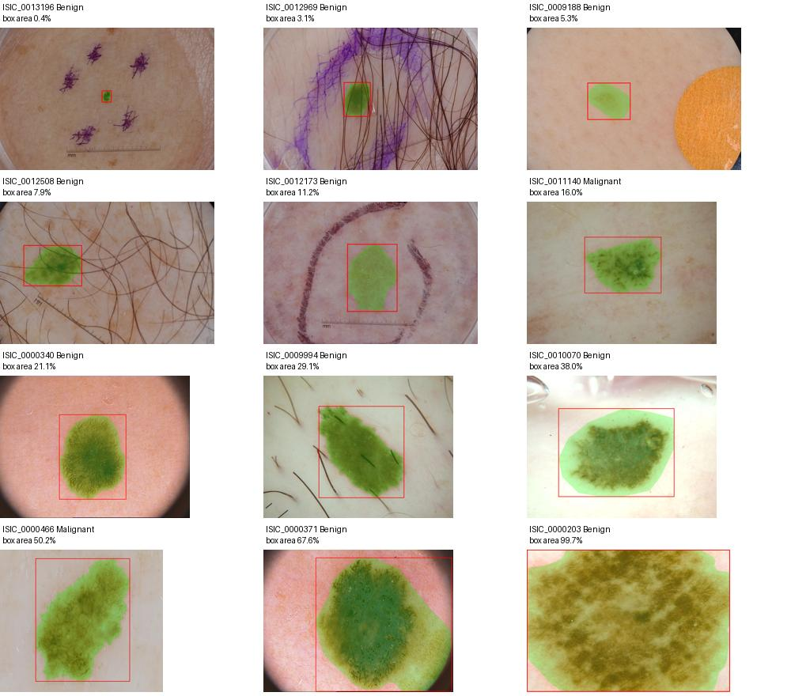

# YOLO11 for Lesion Detection and Triage on ISIC2018 Dataset

## COMP3710 - Pattern Recognition and Analysis

| Task 3 | Lesion Detection: Dermoscopic Screening and Triage |
| :----- | :------------------------------------------------- |
| Author | Alex Janevik (47041585)                            |

## Project Overview

YOLO11 is a single-stage object detection model that can simultaneously predict bounding boxes and class labels for objects in images. In this project, YOLO11 is applied to the ISIC2018 Challenge Dataset to detect and classify skin lesions as either benign or malignant. Care is taken to ensure that the model is trained and evaluated on patient-independent splits. By setting appropriate thresholds for malignant detection, the goal is to assist clinicians in triaging cases by flagging potentially malignant lesions for further review while minimizing unnecessary escalation of benign cases.

Training YOLO11 on the ISIC2018 dataset follows the 3 core stages of the YOLO11 architecture [\[4\]](#references):

1. **Backbone**: Extract features from dermoscopic images at multiple resolutions to produce 3 multi-scale feature maps.
2. **Neck**: Features across the scales are fused to provide context for lesions of different sizes.
3. **Head**: Bounding boxes and classifications are predicted from the fused features.

### put a training visualisation here, perhaps a gif if i can

| \#    | Section                                                                                       |
| ----: | :---------------------------------------------------------------------------------------------|
| 1     | [Project Structure](#project-structure)                                                       |
| 2     | [Dependencies](#dependencies)                                                                 |
| 3     | [Usage](#usage)                                                                               |
| 3.1   |   [Install](#1-install)                                                                       |
| 3.2   |   [Retrieve the data](#2-retrieve-the-data)                                                   |
| 3.3   |   [Build the cohort, split and YOLO dataset](#3-build-the-cohort-split-and-yolo-dataset)      |
| 3.4   |   [Train](#4-train)                                                                           |
| 3.5   |   [Predict on new images](#5-predict-on-new-images)                                           |
| 4     | [Feasibility Review](#feasibility-review)                                                     |
| 5     | [Data Pre-processing](#data-pre-processing)                                                   |
| 6     | [Benchmarks and Results](#benchmarks-and-results)                                             |
| 6.1   |   [Baseline model](#baseline-model)                                                           |
| 6.2   |   [Candidate model](#candidate-model)                                                         |
| 6.3   |   [Comparison](#comparison)                                                                   |
| 7     | [Resource Profiling](#resource-profiling)                                                     |
| 8     | [Qualitative Error Autopsy](#qualitative-error-autopsy)                                       |
| 9     | [Trade-Off Synthesis and Recommendation](#trade-off-synthesis-and-recommendation)             |
| 10    | [Artificial Intelligence Usage Disclosure](#artificial-intelligence-usage-disclosure)         |
| 11    | [References](#references)                                                                     |
| 12    | [Citation](#citation)                                                                         |

## Project Structure

```ansi
yolo_lesion_47041585/
├── README.md
├── pyproject.toml
├── uv.lock
├── configs/
│   ├── a0.yaml
│   ├── b0.yaml
│   ├── base.yaml
│   ├── mps.yaml
│   ├── o35.yaml
│   └── o50.yaml
├── dataset/
│   ├── metadata_raw.csv
│   └── {ISIC2018_...}
├── runs/
├── scripts/
│   ├── fetch_data.sh
│   └── train.slurm
├── src/
│   └── yolo_lesion_47041585/
│       ├── audit.py
│       ├── dataset.py
│       ├── modules.py
│       ├── predict.py
│       ├── train.py
│       └── helpers/
│           ├── evaluation.py
│           ├── policy.py
│           └── visualisation.py
└── weights/
```

## Dependencies

Training was performed on the UQ Rangpur cluster (Alma Linux 8.10) using an NVIDIA A100 GPU (40GB VRAM) with CUDA 13.1.
> **NOTE:** Pilot tests were also performed using MPS on an M1 MacBook Air, though these results are not reported here due to the huge discrepancy in performance. Just keep in mind that it is possible to run this project using MPS. Windows compatibility has not been tested.

| Dependency        | Version           | Use-case                                                                                  |
|-------------------|------------------:|-------------------------------------------------------------------------------------------|
| Python            | 3.12              | Runtime environment                                                                       |
| ultralytics       | 8.4.182           | YOLO11 detector, trainer, validator                                                       |
| torch             | 2.14.1            | Tensor computation, GPU use                                                               |
| torchvision       | 0.29.1            | Installed with ultralytics and torch (not imported directly)                              |
| numpy             | 2.5.4             | Sampling, box geometry                                                                    |
| pillow            | 13.0.0            | Image reading and overlays                                                                |
| pyyaml            | 6.0.3             | Configuration files                                                                       |
| rich              | 15.0.0            | Console output formatting                                                                 |

Dependencies for these packages are all automatically installed when using a virtual environment either in `pip` with `requirements.txt` or `uv` (or equivalent) with `pyproject.toml`. The `uv.lock` file is included to ensure that the same versions of dependencies are installed across different environments.

## Usage

All commands are run from the project folder (`yolo_lesion_47041585/`).

### 1. Install

```bash
uv sync --frozen # installs the exact versions in uv.lock (Python 3.12)
```

Without `uv`, create a Python 3.12 virtual environment and run `pip install -r requirements.txt`.

### 2. Retrieve the data

Before training, you will need to ensure the project has access to the ISIC2018 dataset.

```bash
# if running on UQ Rangpur cluster:
./scripts/fetch_data.sh --rangpur

# otherwise:
./scripts/fetch_data.sh
```

This will place the ISIC2018 dataset into `dataset/` alongside `metadata_raw.csv`.

> **NOTE:** The training images and masks available on Rangpur are `_x2` versions. These are not available from the public ISIC archive, so the results described here are not entirely reproducible without upscaled images. Using the original images will likely provide better results due to the masks being truly binary.

### 3. Build the cohort, split and YOLO dataset

```bash
uv run python -m yolo_lesion_47041585.audit [--source dataset] [--output artifacts/isic2018]
```

This builds the cohort, checks each image against its mask, derives the bounding boxes, splits the images 70/15/15 by patient and exports the result for YOLO. It stops at the first failed check and needs a new or empty output folder. It writes to `artifacts/isic2018`.

| File                              | Contents                                                                   |
|-----------------------------------|----------------------------------------------------------------------------|
| `yolo/`                           | `dataset.yaml`, plus `images/` and `labels/` for `train`, `val` and `test` |
| `split_manifest.csv`              | Split, patient, class and box for every retained image                     |
| `cohort.csv`, `exclusions.csv`    | The retained images and why others were excluded                           |
| `summary.json`                    | Counts and the hashes of the raw metadata and split                        |

The images in `yolo/` are symlinks to absolute paths, so **run this on the machine you will train on**. Do not copy `artifacts/` between machines.

### 4. Train

Each run is one condition, defined by layering config files, with the condition file last:

```bash
uv run train --config configs/base.yaml --config configs/{CONFIG}.yaml
```

| Condition | Augmentation  | Training images drawn         | Malignant share of each epoch |
|-----------|---------------|-------------------------------|-------------------------------|
| `b0`      | none          | stock Ultralytics shuffle     | natural (about 19%)           |
| `a0`      | modest        | with replacement, uniformly   | natural                       |
| `o35`     | modest        | with replacement, weighted    | 35%                           |
| `o50`     | modest        | with replacement, weighted    | 50%                           |

`b0` is the baseline model. It differs from `a0` in two ways at once, so it is not a controlled comparison. The other three conditions are controlled comparisons.

The first run downloads `weights/yolo11n.pt` (COCO-pretrained YOLO11n).

Options:

| Option                    | Effect                                           |
|---------------------------|--------------------------------------------------|
| `--pilot`                 | 3-epoch smoke test. the run is named `...-pilot` |
| `--device cpu\|mps\|0`    | Choose the device (default: Ultralytics decides) |

As mentioned prior, MPS is supported but not recommended. It uses a smaller batch size so the results are not comparable to GPU runs.

A run writes `runs/<condition>-s<seed>/` (it will not overwrite an existing one):

| File                                   | Contents                                                                  |
|----------------------------------------|---------------------------------------------------------------------------|
| `weights/best.pt`, `last.pt`           | Best checkpoint by validation mAP50:95, and the last epoch                |
| `config.resolved.yaml`, `metadata.json`| The exact settings, split and checkpoint hashes, library and GPU versions |
| `results.csv`                          | Losses and validation metrics for each epoch                              |
| `result.json`                          | Epoch and validation times, peak GPU memory, best mAP50:95                |
| `sampling.csv`                         | Per epoch, how many malignant images the sampler drew (sampled runs only) |

On the Rangpur cluster, submit a slurm script from the project folder:

```bash
sbatch scripts/train.slurm configs/{CONFIG}.yaml # add --pilot for a smoke test
```

The log is written to `slurm-yolo-lesion-<jobid>.out` in the project folder.

### 5. Predict on new images

```bash
uv run predict --checkpoint runs/{RUN}/weights/best.pt \
    --images {path/to/images} --output predictions
```

No masks or labels are needed. The output folder must be new or empty. It contains:

- `detections.csv`: every box at confidence 0.001 or above, as `image_id, x_center, y_center, width, height, class_id, class_name, confidence`. Box values are fractions of the original image's width and height.
- `overlays/`: each image with its boxes drawn (green benign, red malignant). Only boxes at `--overlay-conf` (default 0.25) or above are drawn.

The same region can appear twice - once per class - because each class that scores above the threshold keeps its own box. The confidence of the malignant box is what the triage thresholds act on.

## Feasibility Review

### User need, scope and acceptance criteria

This project aims to investigate whether an image detection model can localise annotated lesions in ISIC2018 dermoscopic images, flagging malignant cases for clinical review whilst limiting unnecessary escalation of benign cases. This project will evaluate this trade-off within the supplied dataset rather than establish clinical readiness. The target audience of such a model is dermatologists and other clinicians who may use it to assist in triaging cases for review.

To consider this project a success, the following acceptance criteria must be met:

| Acceptance criterion | Proposed target | Evaluation method |
| :--- | :--- | :--- |
| Malignant lesion detection sensitivity $m$. | $m \geq 90\%$, with a stretch goal of $m \geq 95\%$. | Calculate the percentage of all malignant lesions that are correctly localised and labelled malignant. A bounding box is correct at IoU $\geq 0.5$. Missing or misclassifying a malignant lesion counts as a failure. |
| Unnecessarily escalated benign cases $b$. | $b \leq 30\%$ when measured at the same operating point that achieves target $m$. | Benign escalation will be reported separately for monitoring cases and urgent referrals. Both monitoring and urgent referrals count towards $b$ - absent, conflicting or low-confidence detections are assigned for monitoring. |
| Quality of localisation. | Mean matched-box IoU $\geq 0.8$ per class. | Calculate the average IoU of correctly matched boxes separately for benign and malignant lesions. The number of lesions that were successfully and unsuccessfully matched will be included in this result. |
| Mean processing latency $t$ (seconds). | $t \leq 1$ per image at a batch size of 1. This includes preprocessing, CPU-GPU transfers, inference and post-processing. This does not include file reading/writing. | Measure on UQ Rangpur hardware after a warmup run. GPU model, input resolution and number of timed images will be included in this result. |

> Baseline and candidate models will be compared on the same test split using $\text{mAP}_{50}$, $\text{mAP}_{50:95}$, precision, recall and per-class localisation IoU. Inference throughput (FPS) will also be reported. Thresholds will be selected using validation data to assess malignant sensitivity against benign monitoring and urgent-referral rates. 3-5 representative failure cases in the validation data will also be visualised and analysed.

### Model choice and course concepts

The chosen detector will be YOLO11 due to its ability to predict bounding boxes and class labels within a single detection pass. Bounding boxes will be derived by training with the supplied segmentation masks in the ISIC2018 dataset. The corresponding image metadata will be used to train the classifier to make binary predictions - either "benign" or "malignant". A COCO-pretrained YOLO11n detector tuned on the training split will be used as the baseline detector. The baseline model will be a COCO-pretrained YOLO11n detector tuned on the training split. It will have a fixed configuration and no further tuning. This will be used for testing the project's runtime and VRAM constraints. Individually motivated tweaks will be made to tune the candidate model based on early failure cases. If tuning YOLO11n does not meet the performance targets, YOLO11s or YOLO11m will be considered within the computing budget.

This task requires class prediction, independent evaluation, patient-level splitting and memory/runtime trade-offs - all concepts covered in COMP3710. Using the YOLO11 detector qualifies this project as **Normal Difficulty**.

### Preliminary feasibility evidence

Metadata records were downloaded via the `isic-cli` tool and ISIC2018 test set images, training set images and training set segmentation masks are stored on Rangpur. Segmentation masks for the test set were manually downloaded from the ISIC Archive [\[1\]](#references)-[\[3\]](#references).

The preliminary audit identified 3,594 image-mask pairs. Excluding the 22 records with indeterminate diagnoses left 3,572 records, with 2,313 of these lacking patient identifiers. ISIC makes no concrete claims about records without patient IDs so it cannot be assumed that a record without a patient ID is independent of other records (including those that do have a patient ID). This means that to avoid data leakage and preserve patient-independence across the testing and validation sets, the *entire* dataset is sanitised by removing all records without patient IDs - even those in the training set. This leaves 1,259 binary-labelled images from 999 identified patients, including a total of 241 malignant samples. The audit also identified 59 repeated lesion IDs across 124 images before patient ID filtering, with 97 images sharing 47 lesion IDs after filtering.

The retained records come from the original training and test sets - 390 and 869 images respectively. These sets will be merged and re-split in a 70/15/15 training-validation-test split prior to training. It is imperative to keep all images from each patient together and check for any overlapping lesion IDs. Records with missing lesion IDs will be retained where patient IDs are available, as overlapping lesion IDs indicate a different photo of the same patient's lesion. Metadata pre-sanitising and filtering, mask pairing and bounding-box extraction have also been completed. An example with candidate bounding boxes is shown below.



### Risks, budget and fallback

The primary risk in this project was the missing patient identifiers in the data, but the solution to this leads to a secondary risk of having too few training records to train a model. The dataset is now very imbalanced, with only 241 of the 1,259 usable images being classified as malignant. To address the class imbalance, oversampling of malignant training images with bounding box-aware augmentation will be compared against the baseline. Validation and test sets will not be oversampled or augmented. Improvement will be assessed by using malignant detection recall at the same benign-escalation limit. Per-class detection metrics will also be reported.

Experiments will be run using a single NVIDIA A100 GPU via the COMP3710 Slurm partition on UQ Rangpur. There is no account limit on Rangpur, but a provisional budget of 12 GPU hours is allocated for this project:

- 1 hour for data-loading and training smoke tests
- 3 hours for training the baseline YOLO11n model.
- 3 hours for the oversampling experiments.
- 3 hours for one YOLO11s or YOLO11m candidate experiment.
- 2 hours for evaluation and analysis.

The smoke test will measure epoch time and peak VRAM usage to set an epoch limit for the controlled comparisons. If the projected runtime exceeds this budget, the number of experiments will be reduced. YOLO11s or YOLO11m will only be tested if there are resources remaining.

## Data Pre-processing

## Benchmarks and Results

### Baseline model

### Candidate model

### Comparison

## Resource Profiling

## Qualitative Error Autopsy

## Trade-Off Synthesis and Recommendation

## Artificial Intelligence Usage Disclosure

## References

\[1\] P. Tschandl, C. Rosendahl, and H. Kittler, “The HAM10000 dataset,
a large collection of multi-source dermatoscopic images of common
pigmented skin lesions,” *Sci Data*, vol. 5, no. 1, p. 180161, Aug.
2018, doi:
[10.1038/sdata.2018.161](https://doi.org/10.1038/sdata.2018.161).

\[2\] N. C. F. Codella *et al.*, “Skin Lesion Analysis Toward Melanoma
Detection: A Challenge at the 2017 International Symposium on Biomedical
Imaging (ISBI), Hosted by the International Skin Imaging Collaboration
(ISIC),” Jan. 08, 2018, *arXiv*: arXiv:1710.05006. doi:
[10.48550/arXiv.1710.05006](https://doi.org/10.48550/arXiv.1710.05006).

\[3\] N. Codella *et al.*, “Skin Lesion Analysis Toward Melanoma
Detection 2018: A Challenge Hosted by the International Skin Imaging
Collaboration (ISIC),” Mar. 29, 2019, *arXiv*: arXiv:1902.03368. doi:
[10.48550/arXiv.1902.03368](https://doi.org/10.48550/arXiv.1902.03368).

\[4\] M. Raimbekov and G. Jocher, “YOLO Architecture Explained: From
YOLOv3 to YOLO26,” Ultralytics Docs. \[Online\]. Available:
<https://docs.ultralytics.com/guides/yolo-architecture>

## Citation

If you use this project in your research, please cite:

```bibtex
@misc{janevik2026yolo11,
    title={YOLO11 for Lesion Detection and Triage on ISIC2018 Dataset},
    author={Alex Janevik},
    year={2026},
    url={https://github.com/alexjanevik/PatternAnalysis-2026/tree/topic-recognition/recognition/yolo_lesion_47041585}
```
