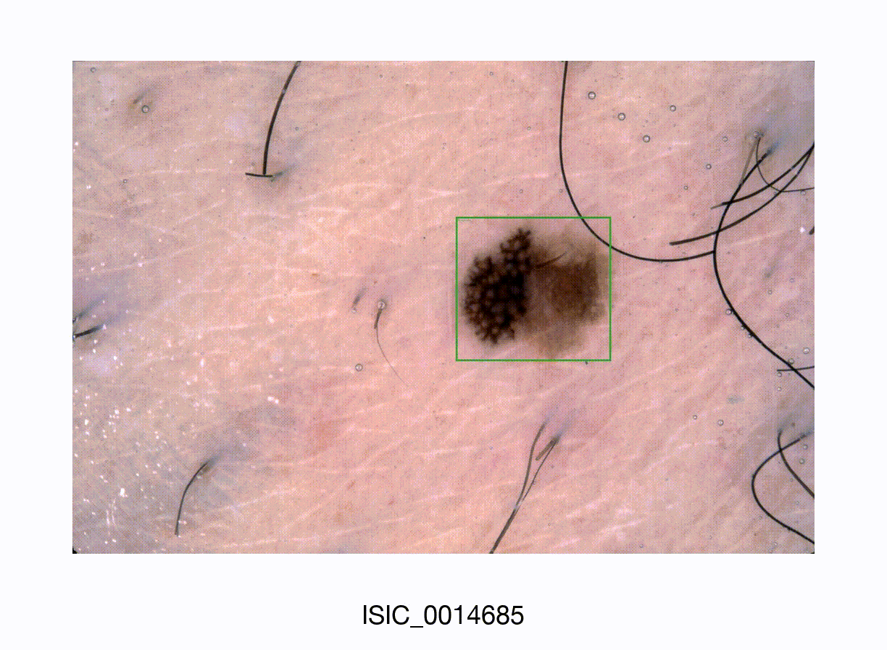
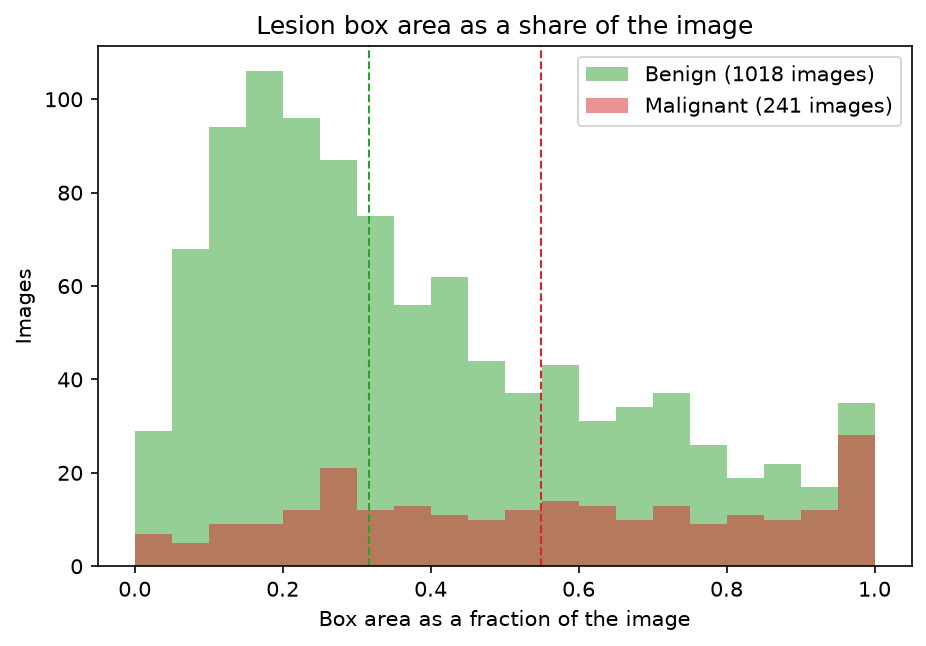
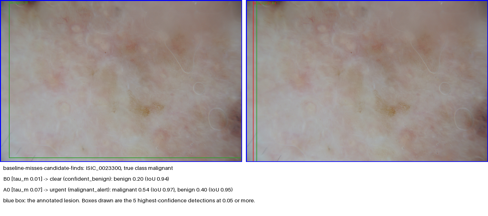
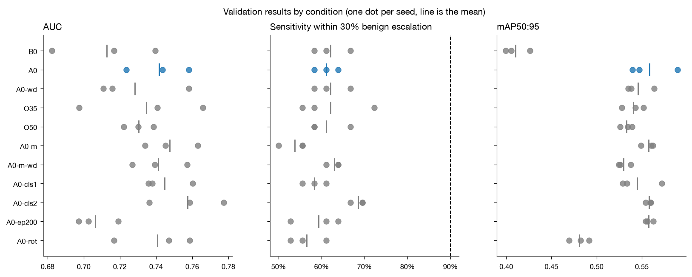
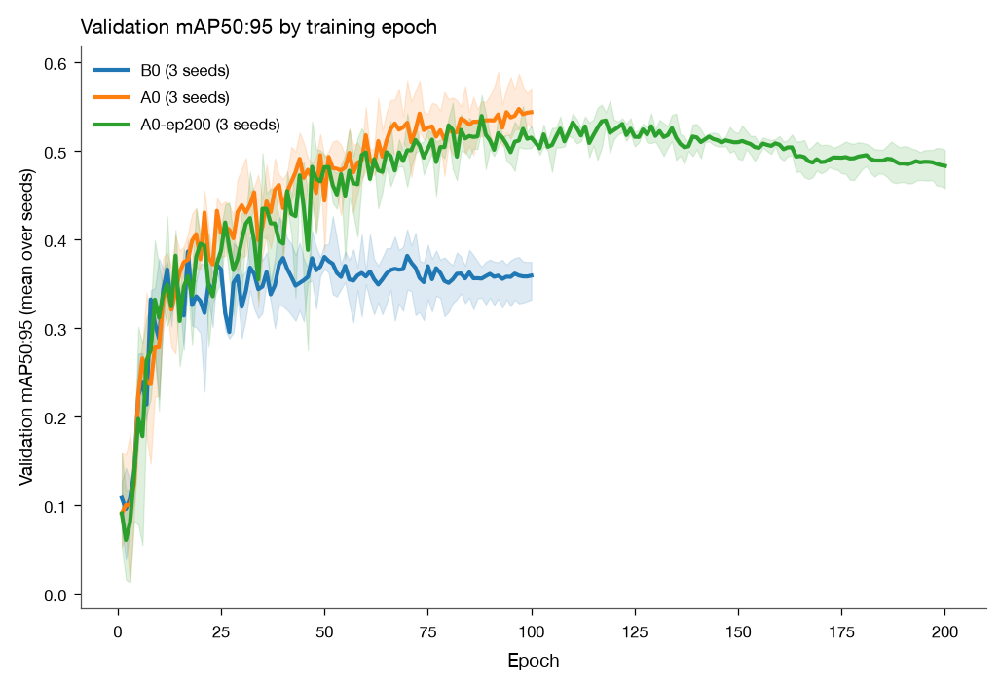
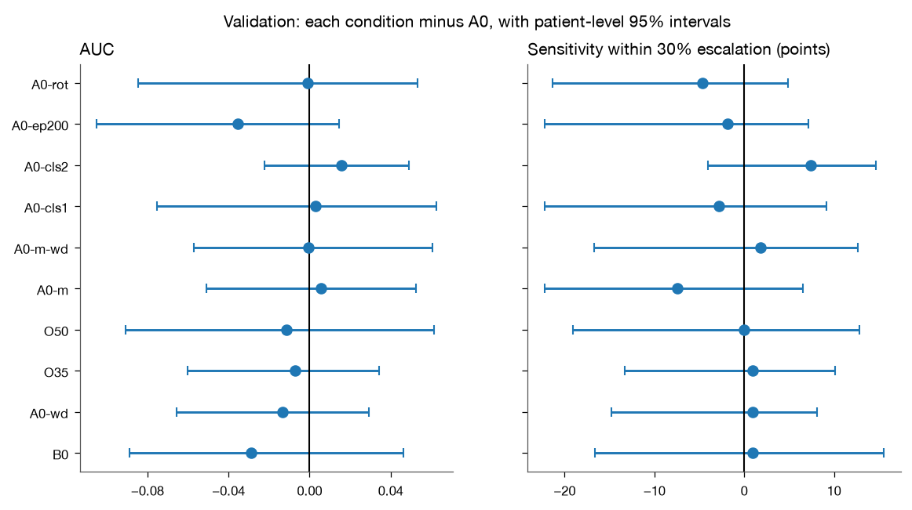
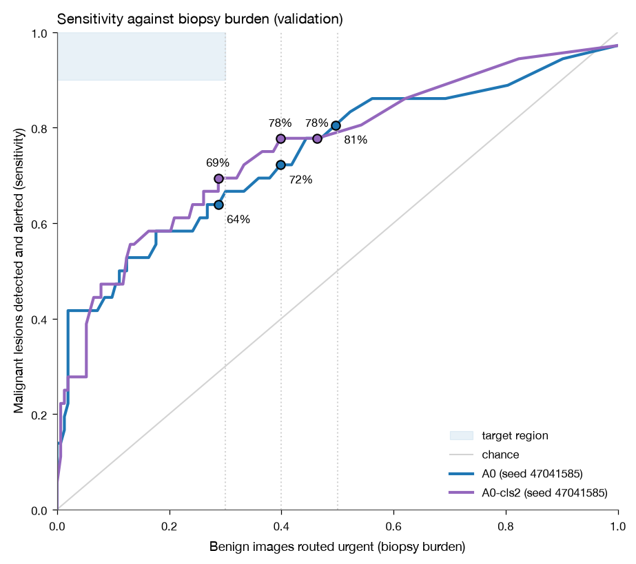
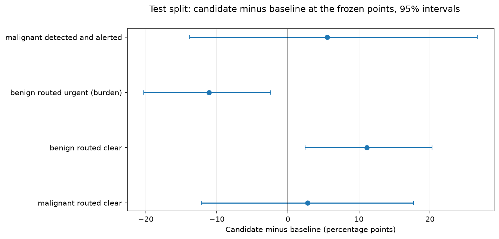
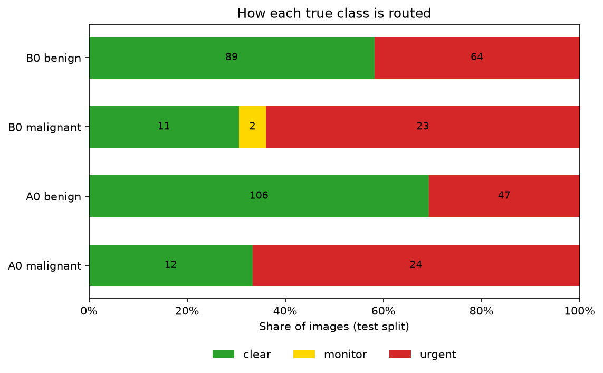
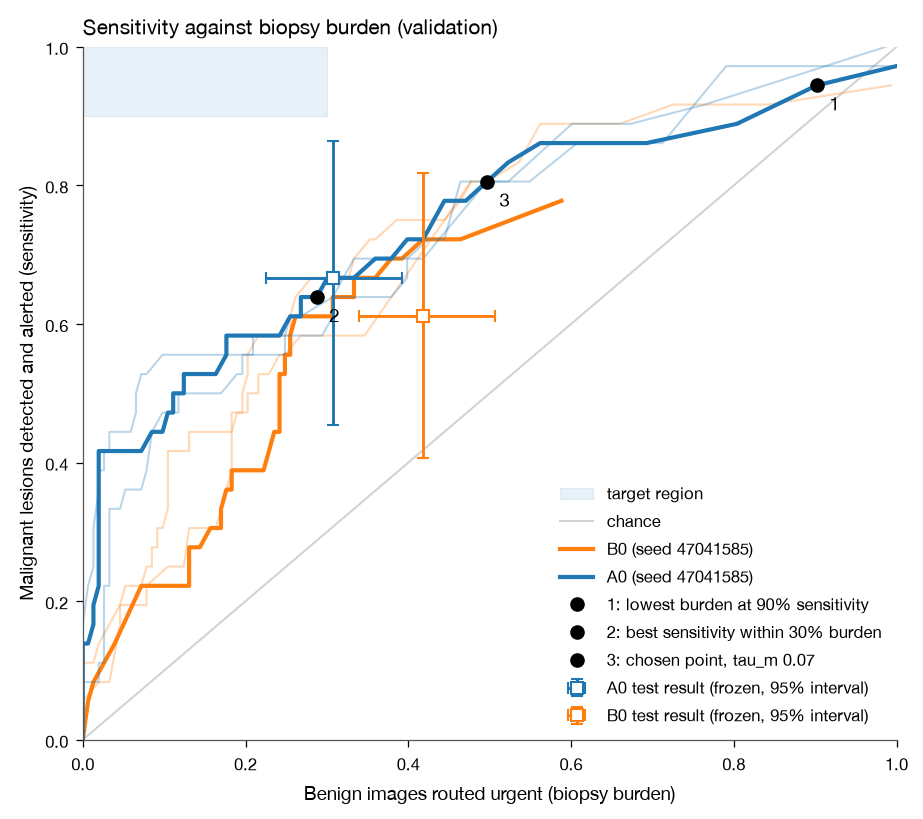

# YOLO11 for Lesion Detection and Triage on ISIC2018 Challenge Dataset

<div align="center">

**COMP3710 - Pattern Recognition and Analysis**

| Task 3 | Lesion Detection: Dermoscopic Screening and Triage |
| :----- | :------------------------------------------------- |
| Author | Alex Janevik (47041585)                            |



[Installation](./docs/INSTALLATION.md) • [Usage](./docs/USAGE.md)

</div>

---

This project trains a YOLO11 object detection model on the ISIC2018 Challenge Dataset to detect and classify skin lesions as either benign or malignant. The primary motivation is to assist clinicians in the triaging of cases by flagging potentially malignant lesions for review while minimising any unnecessary escalated of benign cases. Great care is taken to ensure the model is trained and evaluated on patient-independent splits to avoid data leakage and ensure that the model's performance is representative of real-world clinical scenarios.

Training YOLO11 on the ISIC2018 dataset follows the 3 core stages of the YOLO11 architecture [\[4\]](#references):

1. **Backbone**: Extract features from dermoscopic images at multiple resolutions to produce 3 multi-scale feature maps.
2. **Neck**: Features across the scales are fused to provide context for lesions of different sizes.
3. **Head**: Bounding boxes and classifications are predicted from the fused features.

| \#    | Section                                                                               |
| ----: | :-------------------------------------------------------------------------------------|
| 1     | [Project Structure](#project-structure)                                               |
| 2     | [Initial Feasibility Review](#initial-feasibility-review)                             |
| 3     | [Data preprocessing](#data-preprocessing)                                             |
| 4     | [Benchmarks and Results](#benchmarks-and-results)                                     |
| 4.1   |   [Baseline model](#baseline-model)                                                   |
| 4.2   |   [Config Tuning and Candidate Model](#config-tuning-and-candidate-model)             |
| 4.3   |   [Comparison between Baseline and Candidate Model](#comparison-between-baseline-and-candidate-model)|
| 5     | [Resource Profiling](#resource-profiling)                                             |
| 6     | [Qualitative Error Autopsy](#qualitative-error-autopsy)                               |
| 7     | [Trade-Off Synthesis and Recommendation](#trade-off-synthesis-and-recommendation)     |
| 8     | [Artificial Intelligence Usage Disclosure](#artificial-intelligence-usage-disclosure) |
| 9     | [References](#references)                                                             |
| 10    | [Citation](#citation)                                                                 |

## Project Structure

```ansi
yolo_lesion_47041585/
├── README.md
├── pyproject.toml
├── uv.lock
├── configs/
│   ├── a0.yaml
│   ├── b0.yaml
│   ├── base.yaml
│   ├── mps.yaml
│   ├── o35.yaml
│   └── o50.yaml
├── dataset/
│   ├── metadata_raw.csv
│   └── {ISIC2018_...}
├── runs/
├── scripts/
│   ├── fetch_data.sh
│   └── train.slurm
├── src/
│   └── yolo_lesion_47041585/
│       ├── audit.py
│       ├── dataset.py
│       ├── modules.py
│       ├── predict.py
│       ├── train.py
│       └── helpers/
│           ├── evaluation.py
│           ├── policy.py
│           └── visualisation.py
└── weights/
```

## Initial Feasibility Review

### User need, scope and acceptance criteria

This project aims to investigate whether an image detection model can localise annotated lesions in ISIC2018 dermoscopic images, flagging malignant cases for clinical review whilst limiting unnecessary escalation of benign cases. This project will evaluate this trade-off within the supplied dataset rather than establish clinical readiness. The target audience of such a model is dermatologists and other clinicians who may use it to assist in triaging cases for review.

To consider this project a success, the following acceptance criteria must be met:

| Acceptance criterion | Proposed target | Evaluation method |
| :--- | :--- | :--- |
| Malignant lesion detection sensitivity $m$. | $m \geq 90\%$, with a stretch goal of $m \geq 95\%$. | Calculate the percentage of all malignant lesions that are correctly localised and labelled malignant. A bounding box is correct at IoU $\geq 0.5$. Missing or misclassifying a malignant lesion counts as a failure. |
| Unnecessarily escalated benign cases $b$. | $b \leq 30\%$ when measured at the same operating point that achieves target $m$. | Benign escalation will be reported separately for monitoring cases and urgent referrals. Both monitoring and urgent referrals count towards $b$ - absent, conflicting or low-confidence detections are assigned for monitoring. |
| Quality of localisation. | Mean matched-box IoU $\geq 0.8$ per class. | Calculate the average IoU of correctly matched boxes separately for benign and malignant lesions. The number of lesions that were successfully and unsuccessfully matched will be included in this result. |
| Mean processing latency $t$ (seconds). | $t \leq 1$ per image at a batch size of 1. This includes preprocessing, CPU-GPU transfers, inference and post-processing. This does not include file reading/writing. | Measure on UQ Rangpur hardware after a warmup run. GPU model, input resolution and number of timed images will be included in this result. |

> [!NOTE]
> Baseline and candidate models will be compared on the same test split using mAP$_{50}$ and mAP$_{50:95}$, precision, recall and per-class localisation IoU. Inference throughput (FPS) will also be reported. Thresholds will be selected using validation data to assess malignant sensitivity against benign monitoring and urgent-referral rates. 3-5 representative failure cases in the validation data will also be visualised and analysed.

### Model choice and course concepts

The chosen detector will be YOLO11 due to its ability to predict bounding boxes and class labels within a single detection pass. Bounding boxes will be derived by training with the supplied segmentation masks in the ISIC2018 dataset. The corresponding image metadata will be used to train the classifier to make binary predictions - either "benign" or "malignant". A COCO-pretrained YOLO11n detector tuned on the training split will be used as the baseline detector. It will have a fixed configuration and no further tuning. This will be used for testing the project's runtime and VRAM constraints. Individually motivated tweaks will be made to tune the candidate model based on early failure cases. If tuning YOLO11n does not meet the performance targets, YOLO11s or YOLO11m will be considered within the computing budget.

This task requires class prediction, independent evaluation, patient-level splitting and memory/runtime trade-offs - all concepts covered in COMP3710. Using the YOLO11 detector qualifies this project as **Normal Difficulty**.

### Preliminary feasibility evidence

Metadata records were downloaded via the `isic-cli` tool and ISIC2018 test split images, training split images and training split segmentation masks are stored on Rangpur. Segmentation masks for the test split were manually downloaded from the ISIC Archive [\[1\]](#references)-[\[3\]](#references).

The preliminary audit identified 3,594 image-mask pairs. Excluding the 22 records with indeterminate diagnoses left 3,572 records, with 2,313 of these lacking patient identifiers. ISIC makes no concrete claims about records without patient IDs so it cannot be assumed that a record without a patient ID is independent of other records (including those that do have a patient ID). This means that to avoid data leakage and preserve patient-independence across the testing and validation splits, the *entire* dataset is sanitised by removing all records without patient IDs - even those in the training split. This leaves 1,259 binary-labelled images from 999 identified patients, including a total of 241 malignant samples. The audit also identified 59 repeated lesion IDs across 124 images before patient ID filtering, with 97 images sharing 47 lesion IDs after filtering.

The retained records come from the original training and test splits - 390 and 869 images respectively. These sets will be merged and re-split in a 70/15/15 training-validation-test split prior to training. It is imperative to keep all images from each patient together and check for any overlapping lesion IDs. Records with missing lesion IDs will be retained where patient IDs are available, as overlapping lesion IDs indicate a different photo of the same patient's lesion. Metadata pre-sanitising and filtering, mask pairing and bounding-box extraction have also been completed. An example with candidate bounding boxes is shown below.


<div align="center">

**Figure 1**: Examples of derived bounding boxes from segmentation masks.
</div>

### Risks, budget and fallback

The primary risk in this project was the missing patient identifiers in the data, but the solution to this leads to a secondary risk of having too few training records to train a model. The dataset is now very imbalanced, with only 241 of the 1,259 usable images being classified as malignant. To address the class imbalance, oversampling of malignant training images with bounding box-aware augmentation will be compared against the baseline. Validation and test splits will not be oversampled or augmented. Improvement will be assessed by using malignant detection recall at the same benign-escalation limit. Per-class detection metrics will also be reported.

Experiments will be run using a single NVIDIA A100 GPU via the COMP3710 Slurm partition on UQ Rangpur. There is no account limit on Rangpur, but a provisional budget of 12 GPU hours is allocated for this project:

- 1 hour for data-loading and training smoke tests
- 3 hours for training the baseline YOLO11n model.
- 3 hours for the oversampling experiments.
- 3 hours for one YOLO11s or YOLO11m candidate experiment.
- 2 hours for evaluation and analysis.

The smoke test will measure epoch time and peak VRAM usage to set an epoch limit for the controlled comparisons. If the projected runtime exceeds this budget, the number of experiments will be reduced. YOLO11s or YOLO11m will only be tested if there are resources remaining.

## Data Preprocessing

Data preprocessing is implemented in the `dataset` module and then run via the `audit` module. Raw ISIC2018 data is stored and compared against the provided `dataset/metadata_raw.csv` file. The `audit` module performs the following steps:

1. **Filter metadata and pair with images and masks**: Records are split into by row into image-mask pairs. metadata rows that don't map to both a matching image and mask are removed. records with indeterminate diagnoses or records that don't have a valid patient ID are also removed. Removed records are logged with their respective exclusion reason(s).

2. **Decode pairs and derive their bounding boxes**: All included images and masks are audited to ensure they are valid. Invalid records include those with:

    - Invalid image or mask files.
    - Mask files that are not 8-bit greyscale 2D images.
    - Mismatched dimensions between the image and mask.
    - Masks that are completely empty.

   Once validated, bounding boxes are derived from the segmentation masks in the format [$x_c$, $y_c$, $w$, $h$] with values normalised by image width and height. This is done by finding all non-zero pixels in the mask and calculating the minimum and maximum $x$ and $y$ coordinates.

3. **Build independence groups**: Records that share the same patient ID must reside in the same split to maintain patient-independence across the splits. Records are sorted by ISIC ID and iterated over, placing records with the same patient ID into a group labelled after the first recorded ISIC ID with that patient ID.

4. **Splitting and validation**: Groups are shuffled with a given seed and stable-sorted by size with the largest groups first, with the seed used to break ties between evenly sized groups. Given a set split ratio, class-share targets are generated to try and keep the share of benign and malignant records relatively balanced between splits. Groups are added to splits where the deviation from split's class-share would increase the least if it were added.

   Afterwards, splits are validated to ensure that every split contains both classes and per-record assignments are written to `artifacts/isic2018/split_manifest.csv`.

5. **YOLO export**: Lastly, per-record labels and symlinks to the original images are created in `artifacts/isic2018/yolo`. Each label contains a class (diagnosis) and the bounding box coordinates derived in **(2)**. `artifacts/isic2018/yolo/dataset.yaml` maps the relative paths to each split's images and contains a key for the class labels.

Running audit with seed `47041585` and a 70/15/15 split ratio leaves yields the expected 1,259 records from the [feasibility review](#initial-feasibility-review) with an 881/189/189 split. Each split contains about 19% malignant records with no patient residing in more than one split. 25.3% of malignant records have boxes that cover over 80% of the image, with 9.1% of benign records doing the same. Per run results can be found in `artifacts/isic2018` and lesion-box area distributions are returned during the generation of the box area graph.


<div align="center">

**Figure 2**: How much of the image is covered by the lesion bounding box. Dotted lines indicate the median box area for the respective class label.
</div>

## Benchmarks and Results

Models are evaluated with the acceptance criteria from the [feasibility review](#initial-feasibility-review) as well as a few extra metrics:

- **Sens@ $\leq$ 30%**: The best malignant sensitivity at any alert threshold that escalates at most 30% of benign images.
- **Alert@ $\geq$ 90%**: The lowest benign escalation at any threshold that reaches 90% sensitivity ("unreachable" if none does).
- **IoU**: Mean box overlap with the annotation for correctly matched lesions (per class).
- **AUC**: How well the highest malignant confidence in an image separates malignant from benign images.
- **mAP$_{50}$, mAP$_{50:95}$ and AP**: Ultralytics' standard detection scores, with mAP$_{50}$ being the mean average precision at IoU $\geq 0.5$ and mAP$_{50:95}$ the mean average precision at IoU $\geq 0.5$ to $\geq 0.95$ in increments of 0.05. AP is the average precision at these intervals for individual classes.
- **Strict min escalation**: The lowest benign escalation reachable under the plan's *strict* routing rule.

Routing rules were experimented with to see how they affect the trade-off between malignant sensitivity and benign escalation. These rules decide how an image is routed to clear, monitor or urgent. Sens@ $\leq$ 30% and Alert@ $\geq$ 90% use a *lenient* routing rule. The *strict* rule only clears an image with exactly one detection, which almost never happens at the 0.001 confidence floor. Strict escalation is near 100% for every candidate run and and is erratic for `B0`.

The following configurations were all tested on the same splits and seed(s):

| Condition | Augmentation | Training images drawn | Malignant share of each epoch | Differs from model |
|:----------|:-------------|:----------------------|:------------------------------|:-----------------------|
| `B0` | None | Stock Ultralytics shuffle | Natural (about 19%) | N/A |
| `A0` | Modest | Uniformly with replacement | Natural | `B0`: Augmentation and sampling |
| `A0-wd` | Modest | Uniformly with replacement | Natural | `A0`: Weight decay = `0.05` (default = `0.0005`) |
| `O35` | Modest | Weighted with replacement | 35% | `A0`: Malignant share only |
| `O50` | Modest | Weighted with replacement | 50% | `A0`: Malignant share only |
| `A0-m` | Modest | Uniformly with replacement | Natural | `A0`: YOLO11m weights instead of YOLO11n |
| `A0-m-wd` | Modest | Uniformly with replacement | Natural | `A0-m`: Weight decay = `0.05` |
| `A0-cls1` | Modest | Uniformly with replacement | Natural | `A0`: Classification loss weight = `1.0` (default = `0.5`) |
| `A0-cls2` | Modest | Uniformly with replacement | Natural | `A0`: Classification loss weight = `2.0` (default = `0.5`) |
| `A0-ep200` | Modest | Uniformly with replacement | Natural | `A0`: 200 epochs (default = 100) with a cosine learning-rate schedule |
| `A0-rot` | Modest, plus random rotation up to ±180° | Uniformly with replacement | Natural | `A0`: Rotation only |

### Baseline Model

The baseline model (`B0`) is a COCO-pretrained YOLO11n detector trained on the training split with a shared base config, stock Ultralytics shuffling and no augmentation. The following are the results for `B0` on the validation split:

| condition | seeds | AUC | Sens@ $\leq$ 30% | Alert@ $\geq$ 90% | IoU benign | IoU malignant | strict min escal. | mAP$_{50:95}$ | train time (mins) |
|:--|:--|:--|:--|:--|:---|:---|:---|:--|:---|
| `B0` | 3 | 0.713 ± 0.029 [0.682–0.739] | 62% ± 4% [58%–67%] | 73% ± 0% [73%–73%] (1 of 3 runs reach it) | 0.850 | 0.855 | 72% | 0.410 ± 0.014 [0.399–0.426] | 11 |

`B0` sets the performance floor for this project. Across the three tested seeds (`47041585`, `47041586`, `47041587`) it reaches a mean AUC of 0.71 and a sensitivity of 62% at the benign escalation limit of 30%. This is very far from the 90% sensitivity target. It does meet this target in one of the three runs, but it does so at a benign escalation rate of 73%. This, as well as the AUC ranging from 0.68 to 0.74 and the strict minimum escalation ranging from 54% to 99%, shows us that the results are quite noisy. This seed instability gives good reason to exercise caution when interpreting single-seed results.

Each run trains at an average of around 11 minutes, meaning that the three runs totalling to 33 minutes (plus additional time spent debugging and retraining) fits comfortably within the allocated GPU budget. In the [comparison](#comparison-between-baseline-and-candidate-model) section, `B0` will be the test split comparator.

### Config Tuning and Candidate Model

The primary goal of tuning was to push the malignant sensitivity at the benign escalation limit as high as possible. When tuning the candidate model (`A0`), each condition would change a single hyperparameter or apply a single configuration change - with two exceptions being `A0-ep200` and `A0-m-wd`.

At its core, `A0` is a COCO-pretrained YOLO11n detector like `B0`, but with modest augmentation and uniform sampling with replacement. Augmentation was discussed in the [initial feasibility review](#initial-feasibility-review) as a way to effectively increase the size of the training split after the mass removal of non-patient-independent records. The types of augmentation applied are:

- **Random hue shifts**: Up to $\pm$ 1.5% of the colour wheel
- **Random saturation change**: Up to $\pm$ 40%
- **Random brightness (value) change**: Up to $\pm$ 40%
- **Random translation**: Up to $\pm$ 10% of the image size
- **Random zoom**: Between 80% and 120% of the original size
- **Chance of a vertical flip**: 50%
- **Chance of a horizontal flip**: 50%

The values of these augmentations were chosen to be deliberately modest and were tested among a small range of values in the pilot before settling on the above. Colour augmentation was specifically chosen due to specific failed cases in `B0` where the model was unable to detect a lesion that was very dark or very light. `ISIC_0023300` in particular is very low in contrast, so hue shifting and increasing saturation and brightness may help the model generalise better to these cases. Running this with augmentation now correctly classifies the lesion.


<div align="center">

**Figure 3**: `B0` misses a lesion with low contrast, but `A0` finds it (validation). The lesion is very light and low in contrast, so the model may have been unable to generalise to this case without colour augmentation.
</div>

Below are the results of `A0` as well as the other conditions tested on the validation split. Each condition was run with 3 different seeds to measure the noise in the results:

| condition | seeds | AUC | Sens@$\leq$ 30% | Alert@ $\geq$ 90% | IoU benign | IoU malignant | strict min escal. | mAP$_{50:95}$ | train time (mins) |
|:--|:--|:--|:---|:---|:---|:---|:---|:--|:---|
| `A0` | 3 | 0.742 ± 0.017 [0.723–0.758] | 61% ± 3% [58%–64%] | 82% ± 7% [76%–90%] (3 of 3 runs reach it) | 0.872 | 0.894 | 100% | 0.559 ± 0.027 [0.540–0.589] | 11 |
| `A0-wd` | 3 | 0.728 ± 0.026 [0.711–0.758] | 62% ± 4% [58%–67%] | 84% ± 17% [64%–95%] (3 of 3 runs reach it) | 0.864 | 0.888 | 100% | 0.546 ± 0.016 [0.535–0.564] | 10 |
| `O35` | 3 | 0.735 ± 0.035 [0.698–0.766] | 62% ± 9% [56%–72%] | 90% ± 11% [78%–98%] (3 of 3 runs reach it) | 0.865 | 0.873 | 99% | 0.541 ± 0.012 [0.528–0.552] | 11 |
| `O50` | 3 | 0.730 ± 0.008 [0.722–0.739] | 61% ± 5% [58%–67%] | 83% ± 5% [78%–88%] (3 of 3 runs reach it) | 0.859 | 0.873 | 97% | 0.533 ± 0.007 [0.526–0.539] | 11 |
| `A0-m` | 3 | 0.747 ± 0.015 [0.734–0.763] | 54% ± 3% [50%–56%] | 67% ± 6% [63%–75%] (3 of 3 runs reach it) | 0.862 | 0.888 | 100% | 0.557 ± 0.007 [0.549–0.562] | 24 |
| `A0-m-wd` | 3 | 0.741 ± 0.015 [0.727–0.757] | 63% ± 2% [61%–64%] | 72% ± 16% [61%–90%] (3 of 3 runs reach it) | 0.868 | 0.868 | 100% | 0.530 ± 0.007 [0.525–0.538] | 23 |
| `A0-cls1` | 3 | 0.745 ± 0.014 [0.736–0.760] | 58% ± 3% [56%–61%] | 84% ± 9% [73%–90%] (3 of 3 runs reach it) | 0.863 | 0.876 | 100% | 0.545 ± 0.024 [0.529–0.572] | 10 |
| `A0-cls2` | 3 | 0.758 ± 0.021 [0.736–0.777] | 69% ± 2% [67%–69%] | 88% ± 9% [82%–98%] (3 of 3 runs reach it) | 0.863 | 0.875 | 100% | 0.558 ± 0.003 [0.554–0.560] | 10 |
| `A0-ep200` | 3 | 0.706 ± 0.011 [0.697–0.719] | 59% ± 6% [53%–64%] | 89% ± 10% [83%–100%] (3 of 3 runs reach it) | 0.866 | 0.884 | 100% | 0.558 ± 0.005 [0.554–0.563] | 19 |
| `A0-rot` | 3 | 0.741 ± 0.022 [0.717–0.759] | 56% ± 4% [53%–61%] | 78% ± 7% [71%–86%] (3 of 3 runs reach it) | 0.842 | 0.860 | 100% | 0.481 ± 0.011 [0.469–0.492] | 10 |

This shows that `A0` already improves in mAP$_{50:95}$, Alert@ $\geq$ 90 and both IoU metrics over `B0` (see baseline table) but it does not improve the malignant sensitivity at the benign escalation limit. This is still far from the performance target, but it does show that the combination of augmentation and sampling with replacement can improve the model's performance.

Further configurations were tested in an attempt to further improve the performance of `A0`. These changes were:

- **Class imbalance**: Oversampling malignant images to 35% and 50% of each epoch (`O35`, `O50`). Only about 19% of images are classified as malignant, so drawing more samples may help improve sensitivity.
- **Regularisation**: Increasing the weight decay from 0.0005 to 0.05 (`A0-wd`, `A0-m-wd`). After patient-independent filtering, the training split is very small and overfitting becomes a concern. Increasing weight decay is a cheap way to test for this.
- **Classification loss weight**: Increasing the classification loss weight from 0.5 to 1.0 and 2.0 (`A0-cls1`, `A0-cls2`). `A0` already localises well but it only catches 61% of malignant lesions within the burden (benign routed urgent) limit. This suggests a weak classifier and increasing the classification loss weight may help improve sensitivity.
- **Capacity and training length**: Using a larger YOLO11m model and training for 200 epochs (`A0-m`, `A0-m-wd`, `A0-ep200`). Figure 5 shows that mAP$_{50:95}$ is still increasing at 100 epochs, so training for longer or using a larger model may improve performance.
- **Further augmentation**: Adding random rotation up to $\pm$ 180$^\circ$ (`A0-rot`). Lesions have no inherent orientation, so this may help the model generalise better.


<div align="center">

**Figure 4**: AUC, Sens@ $\leq$ 30% and mAP$_{50:95}$ for each condition on the validation split. Lines indicate the mean of the 3 seeds. Dashed line indicates the target Sens@ $\leq$ 30% of 90%.
</div>

Oversampling had no measurable effect on Sens@ $\leq$ 30% (62% and 61% vs 61% in `A0`). `O35` did have the best Alert@ $\geq$ 90% of all runs, but it has quite a high uncertainty of $\pm$ 11%.

Weight decay had little measurable effect on any metric, with AUC and mAP$_{50:95}$ even being slightly worse than `A0` (though this can be attributed to noise).

Classification loss provided the most promising results, with `A0-cls2` scoring a Sens@ $\leq$ 30\% of 69\% $\pm$ 2% among the tightest uncertainty of all the runs. `A0-cls1` was similar or worse than `A0` in all metrics.

In the [feasibility review](#initial-feasibility-review), it was suggested that a larger model and longer training may improve performance. `A0-m` and `A0-m-wd` were tested and yielded no improvement in scoring with a 2.2x longer training time. `A0-m` was worse than `A0` in Sens@ $\leq$ 30% by 7.4 points. This suggests that the poorer than expected performance is not related to the capacity of the model.

Increasing the training time and using a cosine learning-rate schedule with `A0-ep200` took 1.7x longer to train with an AUC 0.035 points lower than `A0`.


<div align="center">

**Figure 5**: Epoch vs mAP$_{50:95}$ on the validation split (`B0` vs `A0` vs `A0-ep200`). Shaded areas indicate the range of mAP$_{50:95}$ across the three seeds.
</div>

Finally, adding $\pm$ 180$^\circ$ of random rotation to the augmentation pipeline (`A0-rot`) yielded the worst mAP$_{50:95}$ of all runs (0.481) and lower IoU on both classes. This drop in IoU performance specifically could potentially be due to the fact that an axis-aligned box around a rotated lesion would be larger than the lesion, though this was not tested and is merely a hypothesis.

Deciding on a candidate model is difficult due to the noise in the results. `A0-cls2` has the best Sens@ $\leq$ 30% of all runs, but it is still below the target of 90%. It also has among the tightest uncertainty of all runs and a better Alert@ $\geq$ 90% than `A0`, which is promising. However, when looking at the patient-level 95% interval for Sens@ $\leq$ 30% (+4.9 points [-4, +15]), it is suggestive that this increase in performance can potentially be attributed to the noise in the validation split.


<div align="center">

**Figure 6**: Patient-level 95% interval for AUC and Sens@ $\leq$ 30%. Whole patients are resampled to measure noise in the validation split.
</div>

Even with this in mind, `A0-cls2` still outperforms `A0` in Sens@ $\leq$ 30% in all three seeds and AUC while keeping the same cost. It is still a strong candidate. The more pressing issue is the sensitivity-burden tradeoff. It becomes difficult to ignore the fact that 30% benign escalation at 90% malignant sensitivity is not reached by any condition - especially with the amount of data that has been removed to ensure patient-independence. Because of this, the benign escalation requirement was tested at a relaxed 50% limit. It should be stressed that this is a large deviation from the acceptance criteria. This value was chosen after seeing the validation split curves and the 30% results will still be recorded. 50% is also a more realistic target given the limited dataset and when the ultimate goal is to correctly identify malignant lesions, this is a reasonable compromise.

Before deciding on a candidate between `A0` and `A0-cls2`, the trade-off between sensitivity and benign escalation was measured at different points. The following trade-off table and graph uses data measured at a single seed `47041585`:

| condition | burden limit | tau_m | sensitivity | benign urgent (burden) | benign monitor | malignant monitor | malignant cleared |
|:--|:--|:--|:--|:--|:--|:--|:--|
|`A0`| $\leq$ 30% | 0.18 | 64% | 29% | 0% | 0% | 36% |
|`A0`| $\leq$ 40% | 0.11 | 72% | 40% | 0% | 0% | 28% |
|`A0`| $\leq$ 50% | 0.07 | 81% | 50% | 0% | 0% | 19% |
|`A0-cls2`| $\leq$ 30% | 0.11 | 69% | 29% | 0% | 0% | 31% |
|`A0-cls2`| $\leq$ 40% | 0.06 | 78% | 40% | 0% | 0% | 22% |
|`A0-cls2`| $\leq$ 50% | 0.04 | 78% | 46% | 0% | 0% | 22% |


<div align="center">

**Figure 7**: Sensitivity vs benign escalation on the validation split for `A0` and `A0-cls2`.
</div>

`tau_m` is the threshold that gives the highest malignant sensitivity while escalating no more than that specific share of benign images on the validation split. Malignant cleared is the share of malignant images that are falsely cleared (i.e. no detections at or above `tau_m` with a benign detection present).

These results suggest that `A0-cls2` outperforms `A0` at 30% and 40% burden limits, but `A0` performs better at 50% with sensitivity being 3 points higher and malignant cleared being 3 points lower. Malignant cleared is a very important metric, though this difference can also be attributed to noise. It should also be noted that the burden is not matched, with `A0` escalating 50% of benign images and `A0-cls2` escalating 46%.

With all this in mind, `A0` is the selected candidate model to be evaluated on the test split alongside `B0`. `A0-cls2` shows promise, but the benefits aren't separable from sampling noise as the patient-level 95% interval suggests. `A0` also localises better in every tested seed with a mean IoU of 0.872 and 0.894 for benign and malignant lesions respectively, compared to `A0-cls2`'s 0.863 and 0.875. The two tie in mAP$_{50:95}$, but `A0` leads in sensitivity at the 50% benign escalation limit. `tau_m` for `A0` will also be frozen at 0.07 due to it being the lowest threshold that escalates at most 50% of benign images on the validation split.

### Comparison between Baseline and Candidate Model

`A0` was evaluated alongside `B0` on the final held-out test split. Both models use the same seed `47041585` and frozen `tau_m` of 0.07 and 0.01 for `A0` and `B0` respectively. The test split was evaluated once.

It should be noted that `A0` differs from `B0` in both augmentation and sampling, so the comparison is not strictly fair. `B0` was simply a means to establish a performance floor and to ensure the model can be trained within the allocated budget. The following table shows how the models compare when evaluated against the acceptance criteria in the [feasibility review](#initial-feasibility-review):

| Criteria | Proposed Target | `B0` | `A0` | Met |
|:--|:--|:--|:--|:--|
| Malignant sensitivity | $\geq$ 90% | 61.1% [41, 82] | 66.7% [45, 86] | :x: |
| Benign escalation at same point | $\leq$ 30% | 41.8% [34, 51] | 30.7% [22, 39] | :x: |
| Mean matched-box IoU | $\geq$ 0.8 | 0.857 (benign) / 0.847 (malignant) | 0.890 (benign) / 0.872 (malignant) | :white_check_mark: |
| Latency | 1 second per image | 13.0ms | 11.1ms | :white_check_mark: |

The acceptance criteria are not all met, but `A0` does improve over `B0`. Although `A0` gets close to the 30% benign escalation limit on the test split, it does not reach the 90% malignant sensitivity target so it can't be said that it meets the acceptance criteria. Mean matched-box IoU was a much easier target to meet as the model can just score highly only on the easy cases to inflate it's score. YOLO11n is also very fast and exceeds the, in hindsight, very conservative latency target of 1 second per image.

IoU is only averaged over matched lesions, so it should be interpreted with that value in mind (61.1% for `B0` and 66.7% for `A0`). The following are the operating point results:

| Quantity | `B0` | `A0` | `A0` minus `B0` |
|:--|:--|:--|:-- |
| Malignant detected and alerted (at fixed `tau_m`) | 61.1% [41, 82] | 66.7% [45, 86] | +5.6 points [-14, +27] |
| Burden | 41.8% [34, 51] | 30.7% [22, 39] | -11.1 points [-20, -2] |
| Malignant routed clear | 30.6% [14, 50] | 33.3% [14, 55] | +2.8 points [-12, +18] |
| Benign matched (IoU ≥ 0.5) | 94.1% [89, 98] | 99.3% [98, 100] | +5.2 points [+2, +10] |
| Mean matched IoU, benign | 0.857 [0.838, 0.873] | 0.890 [0.875, 0.903] | +0.034 [+0.021, +0.048] |
| Mean matched IoU, malignant | 0.847 [0.792, 0.900] | 0.872 [0.833, 0.909] | +0.024 [-0.025, +0.080] |


<div align="center">

**Figure 8**: `A0` minus `B0` at the frozen points on the test split and patient-level 95% intervals.
</div>

The results show us that `A0` routes fewer benign images for review than `B0` on the test split, 47 vs 64 of 153 benign images to be exact. It also localised benign images better and matches more benign lesions. The improvement in sensitivity is small, with 24 vs 22 malignant lesions being caught with an interval of [-14, +27] points. Because of the very small number of malignant images, one lesion is worth 2.8 points. This means that this increase is not distinguishable from noise.


<div align="center">

**Figure 9**: Routing of each class on the test split with image counts.
</div>

Neither of the models reach the sensitivity target. `A0` clears 12 of the 36 malignant lesions with no follow-up and `B0` clears 11 while sending 2 for monitoring. Of the images that each model routes as urgent, 24/71 are malignant for `A0` and 23/87 for `B0`. The following table shows the AP$_{50}$ and AP$_{50:95}$, mAP$_{50}$ and mAP$_{50:95}$ for each model on the test split:

| Class | `B0` AP$_{50}$ | `B0` AP$_{50:95}$ | `A0` AP$_{50}$ | `A0` AP$_{50:95}$ |
|:--|:--|:--|:--|:--|
| Benign | 0.838 | 0.585 | 0.904 | 0.709 |
| Malignant | 0.266 | 0.182 | 0.535 | 0.357 |
| Mean (mAP) | 0.552 | 0.384 | 0.719 | 0.533 |

Here, we use AP to measure single-class detection performance and mAP to measure the mean across classes. AP values come from a single seed per model and have no confidence intervals. `A0` approximately doubles `B0`'s malignant AP and improves benign AP by a decent margin. This is reflected in the mAP$_{50}$ and mAP$_{50:95}$, with an improvement of around 0.15. This shows that `A0` is a better detector than `B0`, but the malignant AP in particular only uses 36 malignant images.


<div align="center">

**Figure 10**: Frozen test points against the validation trade-off curves for `A0` and `B0`.
</div>

The frozen `tau_m` of 0.07 gives a different operating point on the test set than it did on the validation set. `A0` escalated 30.7% of benign images here over the 49.7% on the validation set, but the sensitivity dropped from 80.6% to 66.7%. Figure 10 shows that `A0`'s test point lies very close to the validation curve but just further down, while `B0`'s is noticeably lower. The sensitivity-tradeoff is translated but the threshold is not as effective here. Because the threshold is so low, small shifts in the scores move the operating point substantially.

This data alone isn't enough to conclude why this is the case. Some drop is to be expected because `tau_m` was chosen to maximise sensitivity on the validation split, so test results should be interpreted cautiously. Each model was evaluated from a single seed and the test split only contains 36 malignant images from 93 patients. This means one lesion moves the sensitivity by 2.8 points, leading to large uncertainty and noise.

## Resource Profiling

## Qualitative Error Autopsy

## Trade-Off Synthesis and Recommendation

## References

\[1\] P. Tschandl, C. Rosendahl, and H. Kittler, “The HAM10000 dataset,
a large collection of multi-source dermatoscopic images of common
pigmented skin lesions,” *Sci Data*, vol. 5, no. 1, p. 180161, Aug.
2018, doi:
[10.1038/sdata.2018.161](https://doi.org/10.1038/sdata.2018.161).

\[2\] N. C. F. Codella *et al.*, “Skin Lesion Analysis Toward Melanoma
Detection: A Challenge at the 2017 International Symposium on Biomedical
Imaging (ISBI), Hosted by the International Skin Imaging Collaboration
(ISIC),” Jan. 08, 2018, *arXiv*: arXiv:1710.05006. doi:
[10.48550/arXiv.1710.05006](https://doi.org/10.48550/arXiv.1710.05006).

\[3\] N. Codella *et al.*, “Skin Lesion Analysis Toward Melanoma
Detection 2018: A Challenge Hosted by the International Skin Imaging
Collaboration (ISIC),” Mar. 29, 2019, *arXiv*: arXiv:1902.03368. doi:
[10.48550/arXiv.1902.03368](https://doi.org/10.48550/arXiv.1902.03368).

\[4\] M. Raimbekov and G. Jocher, “YOLO Architecture Explained: From
YOLOv3 to YOLO26,” Ultralytics Docs. \[Online\]. Available:
<https://docs.ultralytics.com/guides/yolo-architecture>

## Artificial Intelligence Usage Disclosure

In the development of this project, Claude Sonnet 5.5 was used to assist in several areas, including by not strictly limited to:

- Docstring generation and formatting (prompted to follow the [Google Python Style Guide](https://google.github.io/styleguide/pyguide.html)) and bulk comments for YOLO configurations.
- In-depth explanations of specific concepts and outputs, such as:
  - YOLO11 architecture
  - `json` and `csv` dumps of results
  - Potential effects of tuning different hyperparameters on model performance. Due to the set budget and time requirements, many different configurations of the model could not be tested. Many of my suggested configurations were expected by Claude to yield low value, and these were unfortunately excluded from testing. All tested hyperparameter choices were made by myself and can be justified by my previous ML experience and understanding of the topics.
- Planning review. I produced a very in-depth project plan prior to development based on my preliminary data audit and self-determined requirements in the [initial feasibility review](#initial-feasibility-review). This plan included basic requirements for each module and the expected flow of data. It was then grilled and reviewed by Claude to ensure it was consistent and left no room for ambiguity.
- Code boilerplating. Based on the project plan, modules were prefilled with boilerplate functions and classes to hold me to a strict implementation plan. It should be noted that it would not be feasible to expect the foreseeing of all implementation details at the planning stage, so some boilerplate was discarded or modified as the project progressed.
- Code review and refactoring suggestions. Specifically:
  - My code was refactored a number of times during development and testing to improve readability.
  - Changes were suggested in the planning stages of the project, such as using the `dataclasses` module to simplify the writing and reading of data outputs in `dataset.py` and `audit.py`. This greatly improved type safety and was scaled across other applicable modules.
  - The use of `yaml` configuration files for hyperparameter tuning was an early suggestion when tuning the candidate model. This allowed for much faster experimentation and makes the specific changes much easier to track and read.
- Generation of output scripts such as `profile_latency.py`, `autopsy.py`, `score.py` and `final_test.py`. These were largely written by Claude as they primarily consist of interpreting bulk output data to produce a readable result for myself to verify. This code contains very critical information and was proof read and grilled by myself to ensure understanding and correctness.
- Generation of visualisation scripts. After building the first visualisation script, it was obvious that it could be cleaned up and automated to make it easier for myself to customise and generate figures for the report.

> [!IMPORTANT]
> It is important to note that while AI assistance is seen in many areas of this project, the final decisions and implementation were all made and can be justified by myself. No decisions regarding data handling, model architecture, hyperparameter tuning, evaluation, etc. were blindly made by an LLM. Great care was taken to ensure that all decisions and assumptions were made based on my own testing and understanding of the project's requirements and provided data.

## Citation

If you use this project in your research, please cite:

```bibtex
@misc{janevik2026yolo11,
    title={YOLO11 for Lesion Detection and Triage on ISIC2018 Dataset},
    author={Alex Janevik},
    year={2026},
    url={https://github.com/alexjanevik/PatternAnalysis-2026/tree/topic-recognition/recognition/yolo_lesion_47041585}
```
